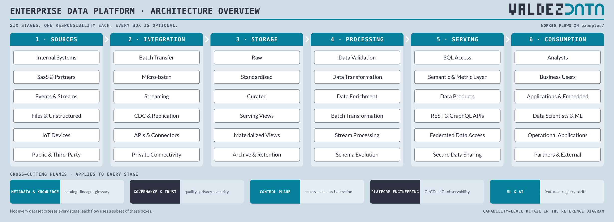
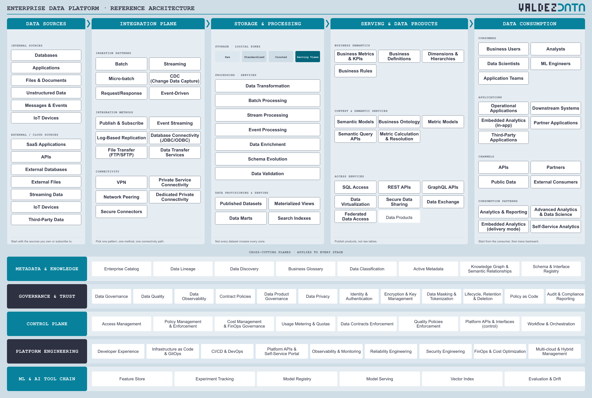
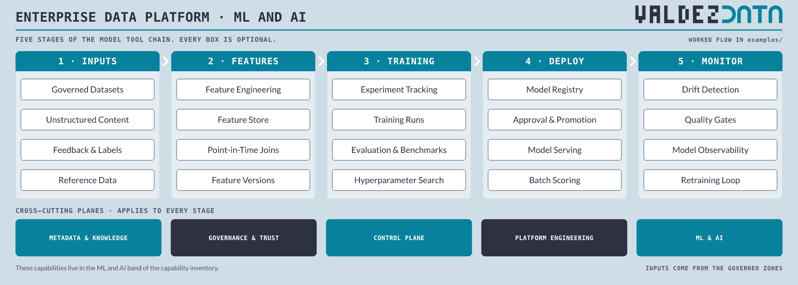

# Enterprise Data Platform Reference Architecture

## A Technology-Agnostic Conceptual Blueprint

**WORK IN PROGRESS**

This repository presents a technology-agnostic conceptual reference architecture for modern enterprise data platforms. It describes the logical capabilities required to acquire, integrate, process, govern, publish, and consume enterprise data.

**Who is this for?**

- General public curious about how organizations handle data
- Junior and mid-level engineers learning data platform concepts
- Anyone who wants to understand data architecture without vendor-specific jargon

The architecture is **vendor-neutral**. It does not prescribe a particular cloud provider, storage engine, processing framework, catalog, semantic layer, or orchestration technology.

The diagrams should be interpreted as a **capability and responsibility model**, not as a mandatory physical deployment topology. Organizations may implement multiple capabilities with one technology, or one capability with several technologies, depending on scale, regulation, latency, cost, and operating model.

Not every dataset is expected to pass through every logical zone. The appropriate path depends on the use case, required quality, latency, sensitivity, and consumer contract.

---

## The Big Picture

Three views: the stages, the capabilities inside them, and a second tool chain for machine learning.

### Overview: the stages and the flow

The overview answers one question: **what are the stages, in what order, and how does data move through them?** Six stages, one concern each, using the same vocabulary as the detailed diagram below. Every box is optional.

| Stage | Where it sits in the detailed view | Guide |
| --- | --- | --- |
| 1 · Sources | Data Sources | [Data Sources](guide/01-data-sources.md) |
| 2 · Integration | Integration Plane | [Integration Plane](guide/02-integration-plane.md) |
| 3 · Storage | STORAGE & PROCESSING: Storage · Logical Zones | [Enterprise Platform](guide/03-enterprise-platform.md) |
| 4 · Processing | STORAGE & PROCESSING: Processing · Services | [Enterprise Platform](guide/03-enterprise-platform.md) |
| 5 · Serving | Serving & Data Products, Access Services | [Serving & Access](guide/04-serving-access.md), [Data Products](guide/05-data-products.md) |
| 6 · Consumption | Data Consumption | [Consumption](guide/06-consumption.md) |

The five cross-cutting planes (metadata and knowledge, governance and trust, control plane, platform engineering, ML and AI) apply to every stage and are shown as a single band beneath the stages. They are expanded into their full capability lists in the guide and in the detailed inventory.

Every box in the overview carries the same name as its counterpart in the detailed inventory, with two exceptions where the inventory models the same idea at a different level:

| Overview box | Where it lives in the inventory |
| --- | --- |
| Data Products | Access Services, and [chapter 5](guide/05-data-products.md) |
| APIs & Connectors | Integration Methods: Database Connectivity, File Transfer, Data Transfer Services, Secure Connectors |
| Archive & Retention | Lifecycle, Retention & Deletion, in the governance plane |

### Detailed inventory: every capability

The detailed diagram is the same architecture at capability level: five stages across the top and five cross-cutting planes beneath. Each box is a capability you can mark as present, partial, or missing when mapping your own platform, so gaps are visible at a glance. Use the overview to agree on the shape of the pipeline, then use this inventory to plan the work.

The overview and every example image are generated from [`tools/diagram_builder.py`](tools/diagram_builder.py); run `python3 -m tools.build --write` after changing it. The detailed inventory, [`diagrams/dataArchitectureReference.svg`](diagrams/dataArchitectureReference.svg), is hand-authored. Both use DM Sans for card text and Source Code Pro for headings and labels; the PNGs above are the rendered versions.

### ML and AI: a second tool chain

Machine learning is not another stage of the data pipeline. It reads from the same governed zones and then goes its own way: features, training, deployment, monitoring. Five stages, and the same five cross-cutting planes apply to all of them.

The same six capabilities appear as a band at the bottom of the [capability inventory](#detailed-inventory-every-capability), which is the flat list. This view is the one that shows how they connect, because a band cannot express that training reads from the feature store and serving reads from the same one. Drawing the tool chain separately also means the pipeline does not grow a column it does not need, and model serving does not have to be smuggled into a SQL box.

### How to Use It

Do not paint every box. Pick one real data flow, follow it left to right, and mark only the capabilities it touches. An empty box is either not applicable or a gap to plan for.

Start with the overview to agree on the stages and the flow, then drop into the detailed inventory to name the capabilities along it.

Nine flows are already traced at both altitudes in [Worked Flows](examples/README.md), chosen so that each one uses a different mix of Storage, Processing and Serving. Two publish a data product; the others serve through SQL access, APIs, federated access or a sharing grant, and one stores nothing at all. Each flow explains why it is in the catalogue, then lists its stages and capabilities, each capability with a plain-language line and a link to the guide chapter behind it.

No single flow uses every box. The diagrams are a superset, and each pipeline takes a subset of it.

Think of an enterprise data platform like a **city's water utility system**:

| Water System                         | Data Platform Equivalent                               |
| ------------------------------------ | ------------------------------------------------------ |
| Rivers, wells, rainwater             | Data Sources (where data originates)                   |
| Pipes, pumps, treatment plants       | Integration Plane (how data moves)                     |
| Reservoirs, purification facilities  | Enterprise Platform (where data is stored & processed) |
| Taps, meters, delivery trucks        | Serving & Access (how people get data)                 |
| Bottled water, municipal supply      | Data Products (packaged, trusted outputs)              |
| Homes, factories, farms              | Consumers (who uses the data)                          |
| Water quality testing, regulations   | Governance & Trust (keeping it safe & reliable)        |
| Utility management office            | Control Plane (managing the whole system)              |
| Engineering crews, maintenance tools | Platform Engineering (building & maintaining it)       |

Just as a city doesn't need every drop of water to go through every treatment stage, not every piece of data needs to flow through every layer of this architecture. The goal is **fit-for-purpose**: right quality, right speed, right access — nothing more, nothing less.

## Operating Model

This reference architecture supports a hybrid operating model.

Shared platform teams manage the common infrastructure and capabilities, including integration, security, governance, observability, developer experience, and platform services.

A useful way to think about this is as an internal platform-as-a-service for data teams. Business domains receive controlled environments, reusable tools, automated workflows, and governance guardrails so they can build and operate data products without managing the entire underlying platform themselves.

Business domains use these shared capabilities to build, operate, evolve, and publish trusted data products. In many organizations, central teams manage ingestion and raw data, while domains take responsibility from the standardized or curated zones through serving. More mature domains may also own their ingestion and raw pipelines.

The **Business Data Products** section represents a logical portfolio of discoverable and supported data products, not an additional physical data zone. A product may be implemented through curated datasets, serving models, semantic definitions, APIs, contracts, documentation, quality controls, and service-level objectives.

---

## Guide: Walk Through Each Section

Each section below explains **what it is**, **when you need it**, **why it matters**, and includes a real-world analogy to make the concept stick.

| #   | Section                                                  | What You'll Learn                                                               |
| --- | -------------------------------------------------------- | ------------------------------------------------------------------------------- |
| 1   | [Data Sources](guide/01-data-sources.md)                 | Where data comes from — internal systems, external partners, sensors, files     |
| 2   | [Integration Plane](guide/02-integration-plane.md)       | How data moves — batch, streaming, CDC, APIs, connectivity                      |
| 3   | [Enterprise Platform](guide/03-enterprise-platform.md)   | Where data lives and gets processed — raw, standardized, curated, serving zones |
| 4   | [Serving & Access](guide/04-serving-access.md)           | How people and apps get data — SQL, APIs, semantic models, virtualization       |
| 5   | [Data Products](guide/05-data-products.md)               | Trusted, reusable data offerings aligned with business outcomes                 |
| 6   | [Consumption](guide/06-consumption.md)                   | Who uses data and how — analysts, scientists, apps, partners                    |
| 7   | [Metadata & Knowledge](guide/07-metadata-knowledge.md)   | How we understand our data — catalogs, lineage, glossaries, discovery           |
| 8   | [Governance & Trust](guide/08-governance-trust.md)       | Keeping data safe, reliable, compliant — quality, privacy, security, policies   |
| 9   | [Control Plane](guide/09-control-plane.md)               | Managing the platform — access, enforcement, cost, orchestration                |
| 10  | [Platform Engineering](guide/10-platform-engineering.md) | Building and maintaining the platform — DevOps, self-service, reliability       |
| 11  | [Worked Flows](examples/README.md)                       | Nine real flows traced through the architecture — batch, streaming, ML, BI, IoT  |

---

## What This Architecture Does NOT Specify

This diagram intentionally does **not** define:

- Specific vendors or products
- A mandatory cloud provider
- Physical deployment topology
- Network subnets or regions
- Exact storage formats
- A mandatory data modeling methodology
- A universal latency target
- Organization-specific compliance obligations

Those decisions belong in implementation architectures and Architecture Decision Records (ADRs).

---

## Prior Art and Inspiration

The shape of this repository follows the reference-architecture convention popularised by a16z's [Emerging Architectures for Modern Data Infrastructure](https://a16z.com/emerging-architectures-for-modern-data-infrastructure/). The left-to-right stack with one concern per column, and the idea of a separate view for the machine learning tool chain, are theirs, and they are good conventions.

What is borrowed: the ordering from sources through ingestion, storage and processing to analysis, the presentation of capabilities rather than a single deployment, and the split between a unified stack and an ML stack.

What is not borrowed: the capability list itself, the five cross-cutting planes, the operating model, and the worked flows. Their diagrams are market maps with vendors in every box. This one is vendor-neutral on purpose, which is why the boxes read "CDC" and "Semantic Models" instead of product names.

Where their work is the better source, this document says so. The machine learning and AI tool chain is one such area; see [ML and AI coverage](examples/README.md#ml-and-ai-coverage).

---

## License

This work is licensed under the [Creative Commons Attribution 4.0 International License](https://creativecommons.org/licenses/by/4.0/). You are free to share and adapt this material for any purpose, including commercial use, as long as you give appropriate credit.

## Contributing

This is a **living document**. The diagram and its explanations will evolve as the data platform landscape changes — whether through community feedback or my own additions over time. If you spot something outdated, unclear, or missing:

1. Open an issue describing what should change and why
2. Or submit a pull request with your proposed improvement

All contributions should maintain the technology-agnostic, educational tone of this repository. Specific vendor recommendations belong in implementation guides, not in this reference architecture.

Generated files should not be edited by hand. See [CONTRIBUTING.md](CONTRIBUTING.md) for the build commands, and run `python3 -m tools.build --check` before opening a pull request.

## A Note on Evolution

This reference architecture captures current best practices as of its publication date. Data platform patterns continue to evolve — new capabilities emerge, old ones fade, and terminology shifts. The diagram and explanations here are **not final**. Expect updates over time as the field matures and community feedback shapes improvements. Treat this as a starting point for discussion, not a definitive standard.
