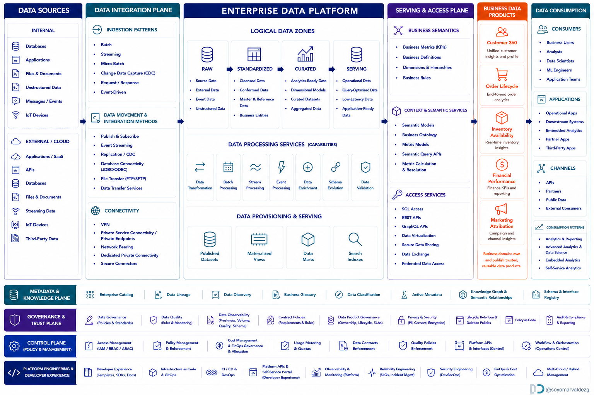

# Enterprise Data Platform Reference Architecture

## A Technology-Agnostic Conceptual Blueprint

This repository presents a technology-agnostic conceptual reference architecture for modern enterprise data platforms. It describes the logical capabilities required to acquire, integrate, process, govern, publish, and consume enterprise data.

**Who is this for?**
- General public curious about how organizations handle data
- Junior and mid-level engineers learning data platform concepts
- Anyone who wants to understand data architecture without vendor-specific jargon

The architecture is **vendor-neutral**. It does not prescribe a particular cloud provider, storage engine, processing framework, catalog, semantic layer, or orchestration technology.

The diagram should be interpreted as a **capability and responsibility model**, not as a mandatory physical deployment topology. Organizations may implement multiple capabilities with one technology, or one capability with several technologies, depending on scale, regulation, latency, cost, and operating model.

Not every dataset is expected to pass through every logical zone. The appropriate path depends on the use case, required quality, latency, sensitivity, and consumer contract.

---

## The Big Picture

Think of an enterprise data platform like a **city's water utility system**:

| Water System | Data Platform Equivalent |
|---|---|
| Rivers, wells, rainwater | Data Sources (where data originates) |
| Pipes, pumps, treatment plants | Integration Plane (how data moves) |
| Reservoirs, purification facilities | Enterprise Platform (where data is stored & processed) |
| Taps, meters, delivery trucks | Serving & Access (how people get data) |
| Bottled water, municipal supply | Data Products (packaged, trusted outputs) |
| Homes, factories, farms | Consumers (who uses the data) |
| Water quality testing, regulations | Governance & Trust (keeping it safe & reliable) |
| Utility management office | Control Plane (managing the whole system) |
| Engineering crews, maintenance tools | Platform Engineering (building & maintaining it) |

Just as a city doesn't need every drop of water to go through every treatment stage, not every piece of data needs to flow through every layer of this architecture. The goal is **fit-for-purpose**: right quality, right speed, right access — nothing more, nothing less.

---

## Guide: Walk Through Each Section

Each section below explains **what it is**, **when you need it**, **why it matters**, and includes a real-world analogy to make the concept stick.

| # | Section | What You'll Learn |
|---|---------|------------------|
| 1 | [Data Sources](guide/01-data-sources.md) | Where data comes from — internal systems, external partners, sensors, files |
| 2 | [Integration Plane](guide/02-integration-plane.md) | How data moves — batch, streaming, CDC, APIs, connectivity |
| 3 | [Enterprise Platform](guide/03-enterprise-platform.md) | Where data lives and gets processed — raw, standardized, curated, serving zones |
| 4 | [Serving & Access](guide/04-serving-access.md) | How people and apps get data — SQL, APIs, semantic models, virtualization |
| 5 | [Data Products](guide/05-data-products.md) | Trusted, reusable data offerings aligned with business outcomes |
| 6 | [Consumption](guide/06-consumption.md) | Who uses data and how — analysts, scientists, apps, partners |
| 7 | [Metadata & Knowledge](guide/07-metadata-knowledge.md) | How we understand our data — catalogs, lineage, glossaries, discovery |
| 8 | [Governance & Trust](guide/08-governance-trust.md) | Keeping data safe, reliable, compliant — quality, privacy, policies |
| 9 | [Control Plane](guide/09-control-plane.md) | Managing the platform — access, enforcement, cost, orchestration |
| 10 | [Platform Engineering](guide/10-platform-engineering.md) | Building and maintaining the platform — DevOps, self-service, reliability |

---

## What This Architecture Does NOT Specify

This diagram intentionally does **not** define:

- Specific vendors or products
- A mandatory cloud provider
- Physical deployment topology
- Network subnets or regions
- Exact storage formats
- A mandatory data modeling methodology
- A universal latency target
- Organization-specific compliance obligations

Those decisions belong in implementation architectures and Architecture Decision Records (ADRs).

---

## License

This work is licensed under the [Creative Commons Attribution 4.0 International License](https://creativecommons.org/licenses/by/4.0/). You are free to share and adapt this material for any purpose, including commercial use, as long as you give appropriate credit.

## Contributing

This is a **living document**. The diagram and its explanations will evolve as the data platform landscape changes — whether through community feedback or my own additions over time. If you spot something outdated, unclear, or missing:

1. Open an issue describing what should change and why
2. Or submit a pull request with your proposed improvement

All contributions should maintain the technology-agnostic, educational tone of this repository. Specific vendor recommendations belong in implementation guides, not in this reference architecture.

## A Note on Evolution

This reference architecture captures current best practices as of its publication date. Data platform patterns continue to evolve — new capabilities emerge, old ones fade, and terminology shifts. The diagram and explanations here are **not final**. Expect updates over time as the field matures and community feedback shapes improvements. Treat this as a starting point for discussion, not a definitive standard.
