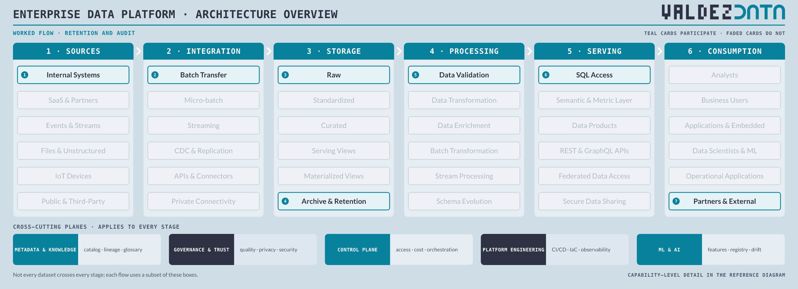
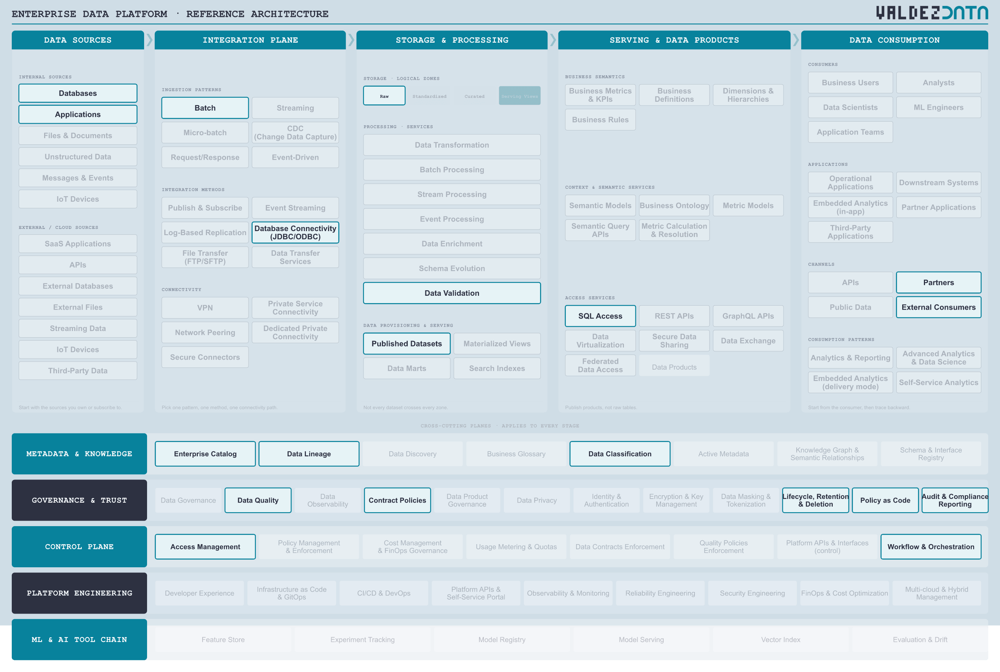

# Retention and audit

A slow, boring, legally required flow. Records land once, are held for years under a retention rule, can be queried by an auditor on demand, and must eventually be deleted with proof. Nothing here is fast, and that is the point.

## Why this flow is in the catalogue

- It turns a policy sentence into a pipeline: keep records readable for years, then prove they are gone.
- It is the only flow where deletion is a feature rather than an accident. Auditors ask for evidence, not assurances.
- It exercises the least-used box in the overview, `Archive & Retention`, which until now was an untested claim.

## Stages

| Step | Stage | Box | Guide chapter |
| --- | --- | --- | --- |
| 1 | Sources | Internal Systems | [Sources](../guide/01-data-sources.md) |
| 2 | Integration | Batch Transfer | [Integration](../guide/02-integration-plane.md) |
| 3 | Storage | Raw | [Storage](../guide/03-enterprise-platform.md) |
| 4 | Storage | Archive & Retention | [Storage](../guide/03-enterprise-platform.md) |
| 5 | Processing | Data Validation | [Processing](../guide/03-enterprise-platform.md) |
| 6 | Serving | SQL Access | [Serving](../guide/04-serving-access.md) |
| 7 | Consumption | Partners & External | [Consumption](../guide/06-consumption.md) |

## Capabilities

| Step | Capability | Plane | In plain terms |
| --- | --- | --- | --- |
| 1 | Databases | [Data Sources](../guide/01-data-sources.md) | Where applications keep their records of truth. |
| 2 | Applications | [Data Sources](../guide/01-data-sources.md) | The software the business runs on: ERP, CRM, billing. |
| 3 | Batch | [Integration Plane](../guide/02-integration-plane.md) | Move a whole day of data at once, on a schedule. |
| 4 | Database Connectivity (JDBC/ODBC) | [Integration Plane](../guide/02-integration-plane.md) | The standard way to open a database connection. |
| 5 | Raw | [Enterprise Platform](../guide/03-enterprise-platform.md) | The data exactly as it arrived, untouched. |
| 6 | Data Validation | [Enterprise Platform](../guide/03-enterprise-platform.md) | Check data meets its rules before anyone relies on it. |
| 7 | Published Datasets | [Enterprise Platform](../guide/03-enterprise-platform.md) | A dataset released, deliberately, for others to consume. |
| 8 | SQL Access | [Serving & Data Products](../guide/04-serving-access.md) | Ask questions in SQL over a governed connection. |
| 9 | Partners | [Data Consumption](../guide/06-consumption.md) | Other organisations you exchange data with, under contract. |
| 10 | External Consumers | [Data Consumption](../guide/06-consumption.md) | People outside the company who are allowed to see the data. |
| 11 | Enterprise Catalog | [Metadata & Knowledge](../guide/07-metadata-knowledge.md) | The index of what data exists, and where. |
| 12 | Data Lineage | [Metadata & Knowledge](../guide/07-metadata-knowledge.md) | A map of where data came from and what it feeds. |
| 13 | Data Classification | [Metadata & Knowledge](../guide/07-metadata-knowledge.md) | Labelling data by how sensitive it is. |
| 14 | Data Quality | [Governance & Trust](../guide/08-governance-trust.md) | Checks that data is correct, complete and on time. |
| 15 | Contract Policies | [Governance & Trust](../guide/08-governance-trust.md) | Agreed rules about what a dataset will contain. |
| 16 | Lifecycle, Retention & Deletion | [Governance & Trust](../guide/08-governance-trust.md) | How long data is kept, and how it is really removed. |
| 17 | Policy as Code | [Governance & Trust](../guide/08-governance-trust.md) | Rules written as code, so they can be tested and versioned. |
| 18 | Audit & Compliance Reporting | [Governance & Trust](../guide/08-governance-trust.md) | Evidence, on demand, that the rules were followed. |
| 19 | Access Management | [Control Plane](../guide/09-control-plane.md) | Who is allowed to read what. |
| 20 | Workflow & Orchestration | [Control Plane](../guide/09-control-plane.md) | Deciding what runs when, in what order, and what to do on failure. |

## Not used by this flow

Not a judgement: these capabilities are simply not on the path. Streaming, CDC & Replication, Standardized, Curated, Serving, Materialized Views, Data Products, Semantic & Metric Layer, Business Users.

## Notes

- Only Raw is used before the archive. Standardizing seven-year-old data for a one-off audit is wasted effort, and the auditor wants the record as it was received.
- SQL Access is on the path because the auditor runs their own queries. A report someone else ran is not evidence.
- Lifecycle, Retention & Deletion and Audit & Compliance Reporting are the point of the flow, not supporting cast.

---

Back to [worked flows](README.md) and the [reference architecture](../README.md).
