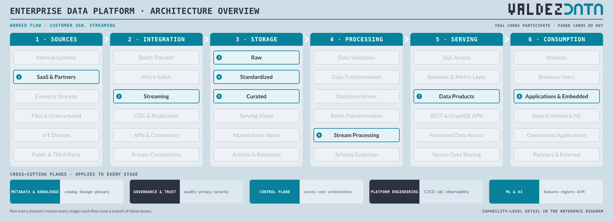
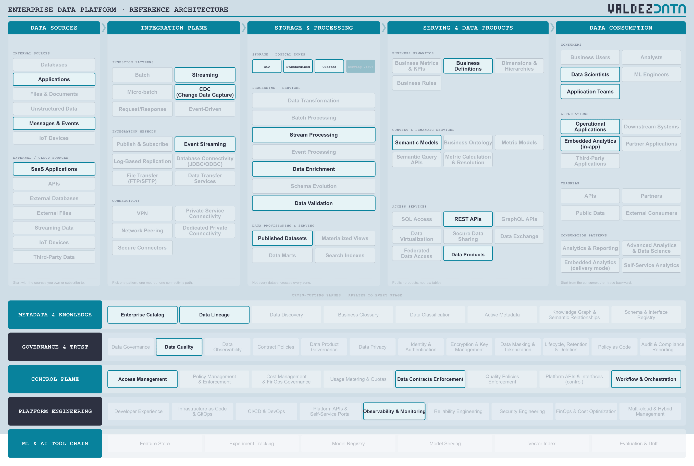

# Customer 360 from operational systems

A streaming flow. SaaS activity and operational events are captured continuously, standardized into one customer identity, and served as an embedded product inside operational applications. Correctness within minutes matters more than completeness within a day.

## Why this flow is in the catalogue

- It is the flow that tells you whether ingestion, storage and processing are genuinely separate concerns. The same three zones serve batch and streaming unchanged.
- It forces identity resolution: one person, three systems, two spellings of their name.
- The consumer is an application, so latency and contract stability outrank completeness. A wrong number delivered in 40 seconds is still wrong.

## Stages

| Step | Stage | Box | Guide chapter |
| --- | --- | --- | --- |
| 1 | Sources | SaaS & Partners | [Sources](../guide/01-data-sources.md) |
| 2 | Integration | Streaming | [Integration](../guide/02-integration-plane.md) |
| 3 | Storage | Raw | [Storage](../guide/03-enterprise-platform.md) |
| 4 | Storage | Standardized | [Storage](../guide/03-enterprise-platform.md) |
| 5 | Storage | Curated | [Storage](../guide/03-enterprise-platform.md) |
| 6 | Processing | Stream Processing | [Processing](../guide/03-enterprise-platform.md) |
| 7 | Serving | Data Products | [Serving](../guide/04-serving-access.md) |
| 8 | Consumption | Applications & Embedded | [Consumption](../guide/06-consumption.md) |

## Capabilities

| Step | Capability | Plane | In plain terms |
| --- | --- | --- | --- |
| 1 | SaaS Applications | [Data Sources](../guide/01-data-sources.md) | Cloud tools: a hosted CRM, billing or support system. |
| 2 | Applications | [Data Sources](../guide/01-data-sources.md) | The software the business runs on: ERP, CRM, billing. |
| 3 | Messages & Events | [Data Sources](../guide/01-data-sources.md) | Signals applications send each other as things happen. |
| 4 | Streaming | [Integration Plane](../guide/02-integration-plane.md) | Move records continuously, as they arrive. |
| 5 | CDC (Change Data Capture) | [Integration Plane](../guide/02-integration-plane.md) | Read the database's change log instead of dumping tables. |
| 6 | Event Streaming | [Integration Plane](../guide/02-integration-plane.md) | A durable log of events that many readers can consume. |
| 7 | Raw | [Enterprise Platform](../guide/03-enterprise-platform.md) | The data exactly as it arrived, untouched. |
| 8 | Standardized | [Enterprise Platform](../guide/03-enterprise-platform.md) | Same names, types and codes regardless of which system it came from. |
| 9 | Curated | [Enterprise Platform](../guide/03-enterprise-platform.md) | Joined, deduplicated, modelled, and trusted enough to publish. |
| 10 | Stream Processing | [Enterprise Platform](../guide/03-enterprise-platform.md) | Reshape data as it flows, before it lands. |
| 11 | Data Enrichment | [Enterprise Platform](../guide/03-enterprise-platform.md) | Add context from other data before anyone uses it. |
| 12 | Data Validation | [Enterprise Platform](../guide/03-enterprise-platform.md) | Check data meets its rules before anyone relies on it. |
| 13 | Published Datasets | [Enterprise Platform](../guide/03-enterprise-platform.md) | A dataset released, deliberately, for others to consume. |
| 14 | Data Products | [Serving & Data Products](../guide/04-serving-access.md) | A packaged, documented, supported dataset with a promise attached. |
| 15 | REST APIs | [Serving & Data Products](../guide/04-serving-access.md) | A simple request-and-response interface for applications. |
| 16 | Semantic Models | [Serving & Data Products](../guide/04-serving-access.md) | Business-friendly definitions sitting over physical tables. |
| 17 | Business Definitions | [Serving & Data Products](../guide/04-serving-access.md) | What a business term means, written down once. |
| 18 | Data Scientists | [Data Consumption](../guide/06-consumption.md) | People who build models and run experiments. |
| 19 | Application Teams | [Data Consumption](../guide/06-consumption.md) | Engineers building software on the platform. |
| 20 | Operational Applications | [Data Consumption](../guide/06-consumption.md) | The systems running the business, now fed by the platform. |
| 21 | Embedded Analytics (in-app) | [Data Consumption](../guide/06-consumption.md) | Charts shown inside another product's screens. |
| 22 | Enterprise Catalog | [Metadata & Knowledge](../guide/07-metadata-knowledge.md) | The index of what data exists, and where. |
| 23 | Data Lineage | [Metadata & Knowledge](../guide/07-metadata-knowledge.md) | A map of where data came from and what it feeds. |
| 24 | Data Quality | [Governance & Trust](../guide/08-governance-trust.md) | Checks that data is correct, complete and on time. |
| 25 | Data Contracts Enforcement | [Control Plane](../guide/09-control-plane.md) | Fail loudly, at the producer, when the promise is broken. |
| 26 | Access Management | [Control Plane](../guide/09-control-plane.md) | Who is allowed to read what. |
| 27 | Workflow & Orchestration | [Control Plane](../guide/09-control-plane.md) | Deciding what runs when, in what order, and what to do on failure. |
| 28 | Observability & Monitoring | [Platform Engineering](../guide/10-platform-engineering.md) | Noticing when something is broken, slow or late. |

## Not used by this flow

Not a judgement: these capabilities are simply not on the path. Batch Transfer, Micro-batch, File Transfer, SQL Access, Business Users, External Consumers.

## Notes

- Streaming and CDC replace batch transfer; the storage zones stay the same, which is the point of keeping ingestion separate from storage.
- Stream Processing does identity resolution and enrichment before the record reaches the curated zone, because the consumer is an application, not a report.
- Data Contracts Enforcement is on the path: an embedded product breaks the moment the contract changes without warning.

---

Back to [worked flows](README.md) and the [reference architecture](../README.md).
