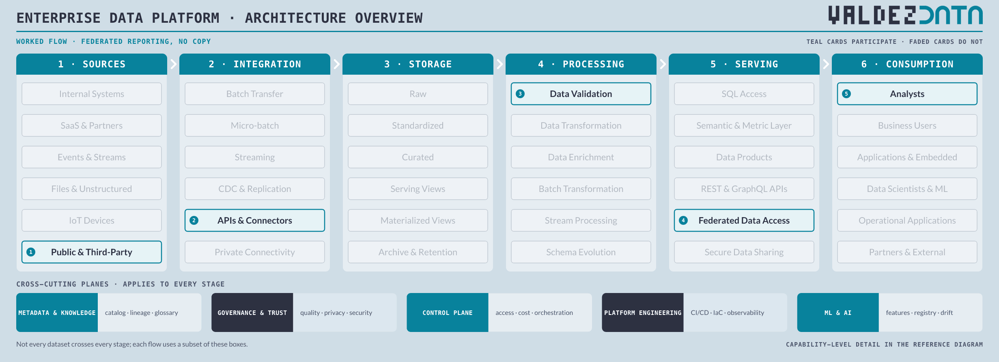
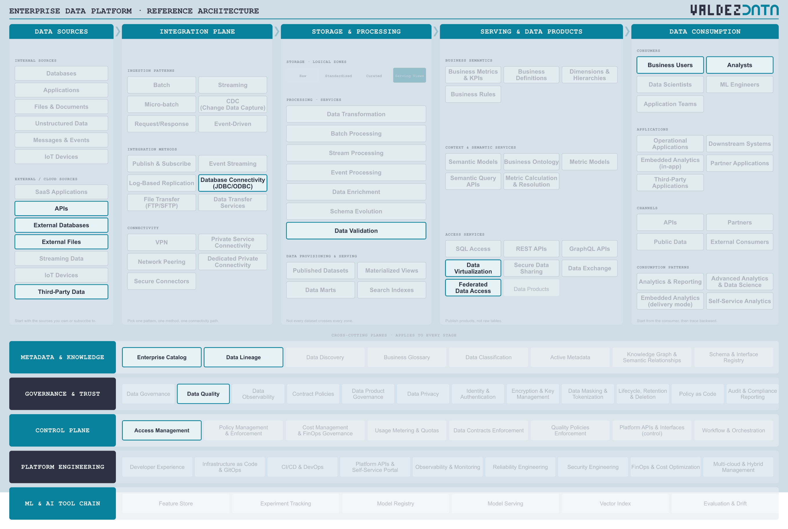

# Federated reporting without copying data

A query-time flow. Third-party data is read where it already lives, validated against its contract at read time, and federated into the analyst's tool. Nothing is landed, so the Storage stage is empty on purpose.

## Why this flow is in the catalogue

- It is the counter-example to every land-everything platform. Some data should never be copied: small, regulated, or changing faster than your pipeline runs.
- It is the cheapest test of whether storage and access are truly decoupled. If a query needs a landing zone, they are not.
- It exposes the cost of no copy: with nothing stored, the catalog and lineage are the only evidence you have when a number looks wrong.

## Stages

| Step | Stage | Box | Guide chapter |
| --- | --- | --- | --- |
| 1 | Sources | Public & Third-Party | [Sources](../guide/01-data-sources.md) |
| 2 | Integration | APIs & Connectors | [Integration](../guide/02-integration-plane.md) |
| 3 | Processing | Data Validation | [Processing](../guide/03-enterprise-platform.md) |
| 4 | Serving | Federated Data Access | [Serving](../guide/04-serving-access.md) |
| 5 | Consumption | Analysts | [Consumption](../guide/06-consumption.md) |

## Capabilities

| Step | Capability | Plane | In plain terms |
| --- | --- | --- | --- |
| 1 | Third-Party Data | [Data Sources](../guide/01-data-sources.md) | Data you buy or subscribe to from a vendor. |
| 2 | External Databases | [Data Sources](../guide/01-data-sources.md) | A database another organisation owns. |
| 3 | External Files | [Data Sources](../guide/01-data-sources.md) | Files a partner drops on a schedule. |
| 4 | APIs | [Data Sources](../guide/01-data-sources.md) | An agreed interface for pulling data out. |
| 5 | Database Connectivity (JDBC/ODBC) | [Integration Plane](../guide/02-integration-plane.md) | The standard way to open a database connection. |
| 6 | Data Validation | [Enterprise Platform](../guide/03-enterprise-platform.md) | Check data meets its rules before anyone relies on it. |
| 7 | Data Virtualization | [Serving & Data Products](../guide/04-serving-access.md) | A query layer that hides where the data physically sits. |
| 8 | Federated Data Access | [Serving & Data Products](../guide/04-serving-access.md) | Query across sources without landing a copy. |
| 9 | Analysts | [Data Consumption](../guide/06-consumption.md) | People who answer business questions with data. |
| 10 | Business Users | [Data Consumption](../guide/06-consumption.md) | People who read dashboards and never write SQL. |
| 11 | Enterprise Catalog | [Metadata & Knowledge](../guide/07-metadata-knowledge.md) | The index of what data exists, and where. |
| 12 | Data Lineage | [Metadata & Knowledge](../guide/07-metadata-knowledge.md) | A map of where data came from and what it feeds. |
| 13 | Data Quality | [Governance & Trust](../guide/08-governance-trust.md) | Checks that data is correct, complete and on time. |
| 14 | Access Management | [Control Plane](../guide/09-control-plane.md) | Who is allowed to read what. |

## Not used by this flow

Not a judgement: these capabilities are simply not on the path. Batch Transfer, CDC & Replication, Raw, Standardized, Curated, Data Products, Semantic & Metric Layer.

## Notes

- Storage is empty. If nothing is landed, raw, standardized and curated do not exist for this flow, and pretending otherwise is how reference architectures become shelfware.
- Validation moves to the read path: the check runs when the query runs, so a broken source fails loudly at the desk instead of silently overnight.
- Enterprise Catalog and Data Lineage carry more weight here, because there is no stored copy left to inspect when something looks wrong.

---

Back to [worked flows](README.md) and the [reference architecture](../README.md).
