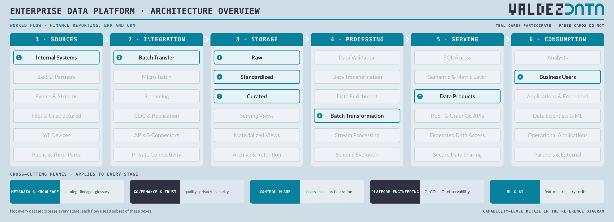
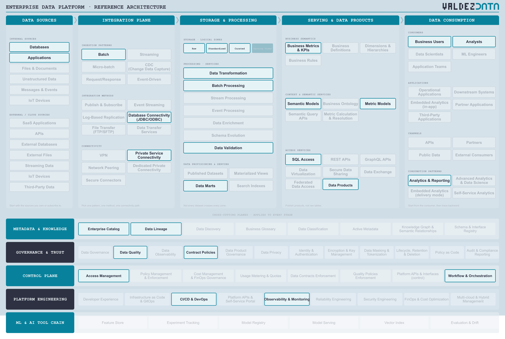

# Finance reporting from an ERP and CRM

A batch flow. Two operational systems land once a night, conform through the three storage zones, and publish a governed financial data product. It is the smallest flow that still exercises the whole platform, which is why it is the first example.

## Why this flow is in the catalogue

- It is the flow almost every organisation already runs, so it is the honest baseline: if this one is hard, nothing else will be easy.
- It forces the reconciliation question. ERP and CRM disagree about the same customer, so `Standardized` has to mean something concrete.
- It ends in a number that leaves the building. That is why contract policies, quality checks and lineage sit on the path rather than beside it.

## Stages

| Step | Stage | Box | Guide chapter |
| --- | --- | --- | --- |
| 1 | Sources | Internal Systems | [Sources](../guide/01-data-sources.md) |
| 2 | Integration | Batch Transfer | [Integration](../guide/02-integration-plane.md) |
| 3 | Storage | Raw | [Storage](../guide/03-enterprise-platform.md) |
| 4 | Storage | Standardized | [Storage](../guide/03-enterprise-platform.md) |
| 5 | Storage | Curated | [Storage](../guide/03-enterprise-platform.md) |
| 6 | Processing | Batch Transformation | [Processing](../guide/03-enterprise-platform.md) |
| 7 | Serving | Data Products | [Serving](../guide/04-serving-access.md) |
| 8 | Consumption | Business Users | [Consumption](../guide/06-consumption.md) |

## Capabilities

| Step | Capability | Plane | In plain terms |
| --- | --- | --- | --- |
| 1 | Databases | [Data Sources](../guide/01-data-sources.md) | Where applications keep their records of truth. |
| 2 | Applications | [Data Sources](../guide/01-data-sources.md) | The software the business runs on: ERP, CRM, billing. |
| 3 | Batch | [Integration Plane](../guide/02-integration-plane.md) | Move a whole day of data at once, on a schedule. |
| 4 | Database Connectivity (JDBC/ODBC) | [Integration Plane](../guide/02-integration-plane.md) | The standard way to open a database connection. |
| 5 | Private Service Connectivity | [Integration Plane](../guide/02-integration-plane.md) | A private network path instead of the public internet. |
| 6 | Raw | [Enterprise Platform](../guide/03-enterprise-platform.md) | The data exactly as it arrived, untouched. |
| 7 | Standardized | [Enterprise Platform](../guide/03-enterprise-platform.md) | Same names, types and codes regardless of which system it came from. |
| 8 | Curated | [Enterprise Platform](../guide/03-enterprise-platform.md) | Joined, deduplicated, modelled, and trusted enough to publish. |
| 9 | Batch Processing | [Enterprise Platform](../guide/03-enterprise-platform.md) | Reshape data in bulk, on a schedule. |
| 10 | Data Transformation | [Enterprise Platform](../guide/03-enterprise-platform.md) | Reshape data: clean it, join it, aggregate it. |
| 11 | Data Validation | [Enterprise Platform](../guide/03-enterprise-platform.md) | Check data meets its rules before anyone relies on it. |
| 12 | Data Marts | [Enterprise Platform](../guide/03-enterprise-platform.md) | A small store built for one team's questions. |
| 13 | SQL Access | [Serving & Data Products](../guide/04-serving-access.md) | Ask questions in SQL over a governed connection. |
| 14 | Semantic Models | [Serving & Data Products](../guide/04-serving-access.md) | Business-friendly definitions sitting over physical tables. |
| 15 | Metric Models | [Serving & Data Products](../guide/04-serving-access.md) | One agreed definition per number, computed in one place. |
| 16 | Business Metrics & KPIs | [Serving & Data Products](../guide/04-serving-access.md) | The numbers the business actually reports. |
| 17 | Data Products | [Serving & Data Products](../guide/04-serving-access.md) | A packaged, documented, supported dataset with a promise attached. |
| 18 | Analysts | [Data Consumption](../guide/06-consumption.md) | People who answer business questions with data. |
| 19 | Business Users | [Data Consumption](../guide/06-consumption.md) | People who read dashboards and never write SQL. |
| 20 | Analytics & Reporting | [Data Consumption](../guide/06-consumption.md) | Dashboards and regular reports. |
| 21 | Enterprise Catalog | [Metadata & Knowledge](../guide/07-metadata-knowledge.md) | The index of what data exists, and where. |
| 22 | Data Lineage | [Metadata & Knowledge](../guide/07-metadata-knowledge.md) | A map of where data came from and what it feeds. |
| 23 | Data Quality | [Governance & Trust](../guide/08-governance-trust.md) | Checks that data is correct, complete and on time. |
| 24 | Contract Policies | [Governance & Trust](../guide/08-governance-trust.md) | Agreed rules about what a dataset will contain. |
| 25 | Access Management | [Control Plane](../guide/09-control-plane.md) | Who is allowed to read what. |
| 26 | Workflow & Orchestration | [Control Plane](../guide/09-control-plane.md) | Deciding what runs when, in what order, and what to do on failure. |
| 27 | CI/CD & DevOps | [Platform Engineering](../guide/10-platform-engineering.md) | Ship platform changes safely, the same way every time. |
| 28 | Observability & Monitoring | [Platform Engineering](../guide/10-platform-engineering.md) | Noticing when something is broken, slow or late. |

## Not used by this flow

Not a judgement: these capabilities are simply not on the path. Streaming, CDC & Replication, Event Processing, GraphQL APIs, IoT Devices, Public Data, External Consumers.

## Notes

- Batch transfer and JDBC connectivity are enough; no streaming path is needed.
- Standardized is where ERP and CRM customer and cost centres are conformed, so the financial numbers reconcile across systems.
- Contract Policies and Data Quality sit on the path because the numbers are published outside the platform, where they cannot be corrected silently.

---

Back to [worked flows](README.md) and the [reference architecture](../README.md).
