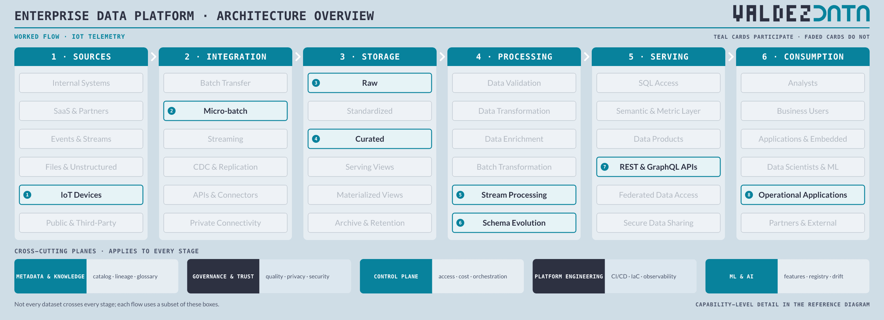
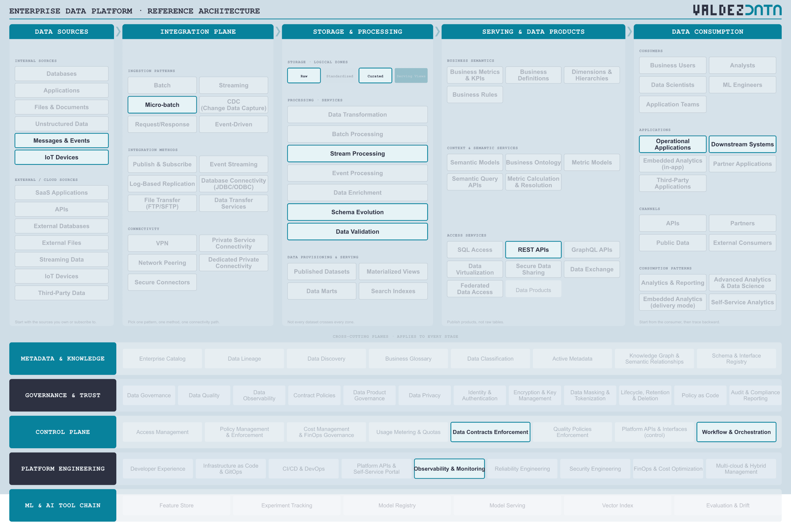

# IoT telemetry from the factory floor

A machine-generated flow. Sensors emit small records continuously, a gateway micro-batches them, and the platform turns them into signals that operations acts on. Nobody writes a report and nobody queries a table.

## Why this flow is in the catalogue

- It makes "high volume, small records" concrete: one factory floor can outproduce every business application in the company combined.
- It shows why micro-batch exists at all. A full stream stack is hard to operate, and thirty-second batches keep the line running just as well.
- It is the flow where schema evolution stops being theoretical: devices get new firmware and start sending fields nobody designed for.

## Stages

| Step | Stage | Box | Guide chapter |
| --- | --- | --- | --- |
| 1 | Sources | IoT Devices | [Sources](../guide/01-data-sources.md) |
| 2 | Integration | Micro-batch | [Integration](../guide/02-integration-plane.md) |
| 3 | Storage | Raw | [Storage](../guide/03-enterprise-platform.md) |
| 4 | Storage | Curated | [Storage](../guide/03-enterprise-platform.md) |
| 5 | Processing | Stream Processing | [Processing](../guide/03-enterprise-platform.md) |
| 6 | Processing | Schema Evolution | [Processing](../guide/03-enterprise-platform.md) |
| 7 | Serving | REST & GraphQL APIs | [Serving](../guide/04-serving-access.md) |
| 8 | Consumption | Operational Applications | [Consumption](../guide/06-consumption.md) |

## Capabilities

| Step | Capability | Plane | In plain terms |
| --- | --- | --- | --- |
| 1 | IoT Devices | [Data Sources](../guide/01-data-sources.md) | Sensors and machines reporting their own state. |
| 2 | Messages & Events | [Data Sources](../guide/01-data-sources.md) | Signals applications send each other as things happen. |
| 3 | Micro-batch | [Integration Plane](../guide/02-integration-plane.md) | Small batches every few seconds, a step short of full streaming. |
| 4 | Raw | [Enterprise Platform](../guide/03-enterprise-platform.md) | The data exactly as it arrived, untouched. |
| 5 | Curated | [Enterprise Platform](../guide/03-enterprise-platform.md) | Joined, deduplicated, modelled, and trusted enough to publish. |
| 6 | Stream Processing | [Enterprise Platform](../guide/03-enterprise-platform.md) | Reshape data as it flows, before it lands. |
| 7 | Schema Evolution | [Enterprise Platform](../guide/03-enterprise-platform.md) | Handling a source that changes shape without breaking what is downstream. |
| 8 | Data Validation | [Enterprise Platform](../guide/03-enterprise-platform.md) | Check data meets its rules before anyone relies on it. |
| 9 | REST APIs | [Serving & Data Products](../guide/04-serving-access.md) | A simple request-and-response interface for applications. |
| 10 | Operational Applications | [Data Consumption](../guide/06-consumption.md) | The systems running the business, now fed by the platform. |
| 11 | Downstream Systems | [Data Consumption](../guide/06-consumption.md) | Other systems that consume the data and act on it. |
| 12 | Data Contracts Enforcement | [Control Plane](../guide/09-control-plane.md) | Fail loudly, at the producer, when the promise is broken. |
| 13 | Observability & Monitoring | [Platform Engineering](../guide/10-platform-engineering.md) | Noticing when something is broken, slow or late. |
| 14 | Workflow & Orchestration | [Control Plane](../guide/09-control-plane.md) | Deciding what runs when, in what order, and what to do on failure. |

## Not used by this flow

Not a judgement: these capabilities are simply not on the path. Batch Transfer, SQL Access, Data Products, Semantic & Metric Layer, Analysts, Business Users.

## Notes

- The raw zone is not skipped. Device payloads are kept exactly as received, because sensors fail in surprising ways and the evidence is the payload.
- Curated holds only the signals operations reacts to; everything else stays raw, cheap, and unmodelled.
- The consumer is a control system, so the interface is REST, not SQL. A dashboard would be the wrong shape for this answer.

---

Back to [worked flows](README.md) and the [reference architecture](../README.md).
