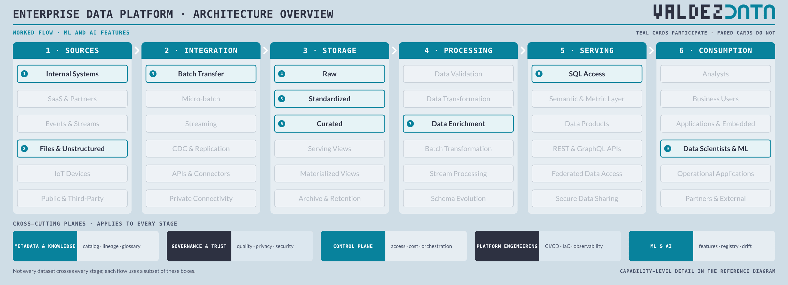
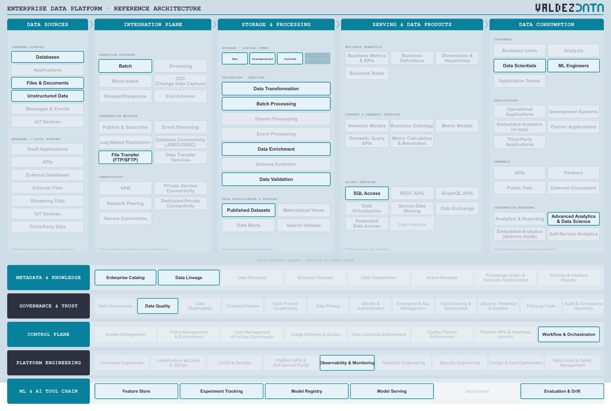

# ML and AI features from governed data

Features for models are built from the same governed zones as BI. That part is cheap and it is where most platforms already succeed. The flow stops where this reference architecture stops.

See also: [ML and AI view](../diagrams/mlAiOverview.png) — the tool chain that the capabilities below belong to.

## Why this flow is in the catalogue

- It proves the platform is not only for reporting. Features come from the same governed zones as BI, which is the cheap part nobody disputes.
- It forces versioning. A model has to know which version of which dataset it learned from, or a regression is untraceable.
- It is the flow that shows the second tool chain is not a separate universe: the features come from the same governed zones as BI.

## Stages

| Step | Stage | Box | Guide chapter |
| --- | --- | --- | --- |
| 1 | Sources | Internal Systems | [Sources](../guide/01-data-sources.md) |
| 2 | Sources | Files & Unstructured | [Sources](../guide/01-data-sources.md) |
| 3 | Integration | Batch Transfer | [Integration](../guide/02-integration-plane.md) |
| 4 | Storage | Raw | [Storage](../guide/03-enterprise-platform.md) |
| 5 | Storage | Standardized | [Storage](../guide/03-enterprise-platform.md) |
| 6 | Storage | Curated | [Storage](../guide/03-enterprise-platform.md) |
| 7 | Processing | Data Enrichment | [Processing](../guide/03-enterprise-platform.md) |
| 8 | Serving | SQL Access | [Serving](../guide/04-serving-access.md) |
| 9 | Consumption | Data Scientists & ML | [Consumption](../guide/06-consumption.md) |

## Capabilities

| Step | Capability | Plane | In plain terms |
| --- | --- | --- | --- |
| 1 | Databases | [Data Sources](../guide/01-data-sources.md) | Where applications keep their records of truth. |
| 2 | Files & Documents | [Data Sources](../guide/01-data-sources.md) | Spreadsheets, PDFs, exports and shared drives. |
| 3 | Unstructured Data | [Data Sources](../guide/01-data-sources.md) | Text, images, audio: data with no fixed columns. |
| 4 | Batch | [Integration Plane](../guide/02-integration-plane.md) | Move a whole day of data at once, on a schedule. |
| 5 | File Transfer (FTP/SFTP) | [Integration Plane](../guide/02-integration-plane.md) | Move files over a secure file protocol. |
| 6 | Raw | [Enterprise Platform](../guide/03-enterprise-platform.md) | The data exactly as it arrived, untouched. |
| 7 | Standardized | [Enterprise Platform](../guide/03-enterprise-platform.md) | Same names, types and codes regardless of which system it came from. |
| 8 | Curated | [Enterprise Platform](../guide/03-enterprise-platform.md) | Joined, deduplicated, modelled, and trusted enough to publish. |
| 9 | Batch Processing | [Enterprise Platform](../guide/03-enterprise-platform.md) | Reshape data in bulk, on a schedule. |
| 10 | Data Transformation | [Enterprise Platform](../guide/03-enterprise-platform.md) | Reshape data: clean it, join it, aggregate it. |
| 11 | Data Enrichment | [Enterprise Platform](../guide/03-enterprise-platform.md) | Add context from other data before anyone uses it. |
| 12 | Data Validation | [Enterprise Platform](../guide/03-enterprise-platform.md) | Check data meets its rules before anyone relies on it. |
| 13 | Published Datasets | [Enterprise Platform](../guide/03-enterprise-platform.md) | A dataset released, deliberately, for others to consume. |
| 14 | SQL Access | [Serving & Data Products](../guide/04-serving-access.md) | Ask questions in SQL over a governed connection. |
| 15 | Feature Store | [ML & AI](../README.md#ml-and-ai-a-second-tool-chain) | Model inputs computed once and served the same way to training and to production. |
| 16 | Experiment Tracking | [ML & AI](../README.md#ml-and-ai-a-second-tool-chain) | A record of what was tried, with which data and which settings. |
| 17 | Model Registry | [ML & AI](../README.md#ml-and-ai-a-second-tool-chain) | The list of which models exist, what they were trained on, and which is live. |
| 18 | Model Serving | [ML & AI](../README.md#ml-and-ai-a-second-tool-chain) | Answering predictions through an endpoint instead of a query. |
| 19 | Evaluation & Drift | [ML & AI](../README.md#ml-and-ai-a-second-tool-chain) | Checking whether a model is still right months after launch. |
| 20 | Data Scientists | [Data Consumption](../guide/06-consumption.md) | People who build models and run experiments. |
| 21 | ML Engineers | [Data Consumption](../guide/06-consumption.md) | People who put models into production and keep them there. |
| 22 | Advanced Analytics & Data Science | [Data Consumption](../guide/06-consumption.md) | Statistical work that goes past reporting. |
| 23 | Enterprise Catalog | [Metadata & Knowledge](../guide/07-metadata-knowledge.md) | The index of what data exists, and where. |
| 24 | Data Lineage | [Metadata & Knowledge](../guide/07-metadata-knowledge.md) | A map of where data came from and what it feeds. |
| 25 | Data Quality | [Governance & Trust](../guide/08-governance-trust.md) | Checks that data is correct, complete and on time. |
| 26 | Workflow & Orchestration | [Control Plane](../guide/09-control-plane.md) | Deciding what runs when, in what order, and what to do on failure. |
| 27 | Observability & Monitoring | [Platform Engineering](../guide/10-platform-engineering.md) | Noticing when something is broken, slow or late. |

## Not used by this flow

Not a judgement: these capabilities are simply not on the path. Streaming, CDC & Replication, Stream Processing, GraphQL APIs, Semantic Models, Business Users, Data Products.

## Notes

- Unstructured Data and Files & Documents are on the path; a model does not only read tables.
- Schema Evolution and Data Validation matter more here than in BI: a silent column change becomes a silently wrong model.
- Data Lineage is not optional. Without it, a regression cannot be traced to the dataset version that caused it.
- No data product is published here. The consumer is a scientist or a training job reading governed datasets through SQL Access, which is a different publish mode, not a lesser one.

## Where this flow continues

The flow leaves the six data stages at SQL Access and continues in the ML and AI band of the inventory. That band is drawn in full, with the connections between the boxes, in the [ML and AI view](../diagrams/mlAiOverview.png).

---

Back to [worked flows](README.md) and the [reference architecture](../README.md).
