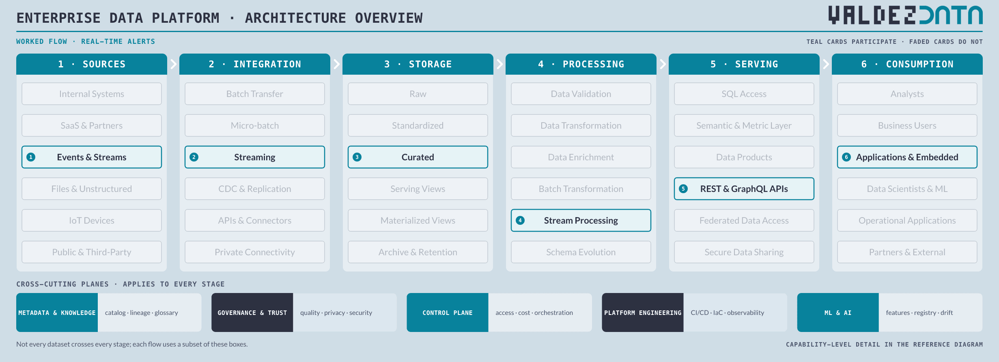
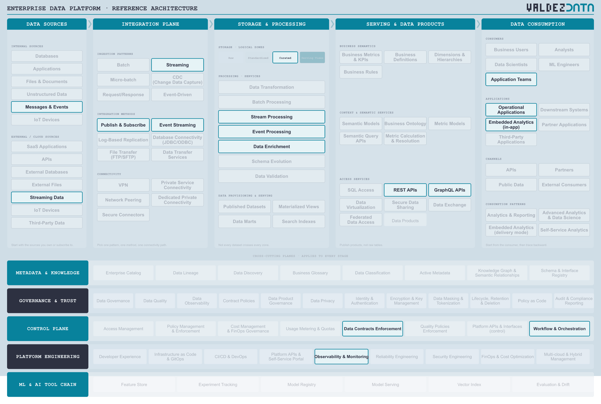

# Real-time alerts from event streams

A sub-minute flow. Operational events are consumed continuously, processed in flight, and pushed back into the application that has to act on them. There is no report and no analyst in the loop.

## Why this flow is in the catalogue

- It compresses the pipeline into seconds and shows what falls away under that constraint: raw landing, batch transformation, reports, analysts.
- It forces the contract question, because an alert consumer breaks the moment a schema changes silently at 2am.
- It proves serving is not only SQL and dashboards. A REST call into an operational app is a first-class publish mode.

## Stages

| Step | Stage | Box | Guide chapter |
| --- | --- | --- | --- |
| 1 | Sources | Events & Streams | [Sources](../guide/01-data-sources.md) |
| 2 | Integration | Streaming | [Integration](../guide/02-integration-plane.md) |
| 3 | Storage | Curated | [Storage](../guide/03-enterprise-platform.md) |
| 4 | Processing | Stream Processing | [Processing](../guide/03-enterprise-platform.md) |
| 5 | Serving | REST & GraphQL APIs | [Serving](../guide/04-serving-access.md) |
| 6 | Consumption | Applications & Embedded | [Consumption](../guide/06-consumption.md) |

## Capabilities

| Step | Capability | Plane | In plain terms |
| --- | --- | --- | --- |
| 1 | Messages & Events | [Data Sources](../guide/01-data-sources.md) | Signals applications send each other as things happen. |
| 2 | Streaming Data | [Data Sources](../guide/01-data-sources.md) | A continuous feed rather than a nightly dump. |
| 3 | Streaming | [Integration Plane](../guide/02-integration-plane.md) | Move records continuously, as they arrive. |
| 4 | Event Streaming | [Integration Plane](../guide/02-integration-plane.md) | A durable log of events that many readers can consume. |
| 5 | Publish & Subscribe | [Integration Plane](../guide/02-integration-plane.md) | One publisher, many subscribers, decoupled in time. |
| 6 | Curated | [Enterprise Platform](../guide/03-enterprise-platform.md) | Joined, deduplicated, modelled, and trusted enough to publish. |
| 7 | Stream Processing | [Enterprise Platform](../guide/03-enterprise-platform.md) | Reshape data as it flows, before it lands. |
| 8 | Event Processing | [Enterprise Platform](../guide/03-enterprise-platform.md) | React to a single event while it is in flight. |
| 9 | Data Enrichment | [Enterprise Platform](../guide/03-enterprise-platform.md) | Add context from other data before anyone uses it. |
| 10 | REST APIs | [Serving & Data Products](../guide/04-serving-access.md) | A simple request-and-response interface for applications. |
| 11 | GraphQL APIs | [Serving & Data Products](../guide/04-serving-access.md) | A query interface where the client asks for exactly the fields it wants. |
| 12 | Application Teams | [Data Consumption](../guide/06-consumption.md) | Engineers building software on the platform. |
| 13 | Operational Applications | [Data Consumption](../guide/06-consumption.md) | The systems running the business, now fed by the platform. |
| 14 | Embedded Analytics (in-app) | [Data Consumption](../guide/06-consumption.md) | Charts shown inside another product's screens. |
| 15 | Data Contracts Enforcement | [Control Plane](../guide/09-control-plane.md) | Fail loudly, at the producer, when the promise is broken. |
| 16 | Observability & Monitoring | [Platform Engineering](../guide/10-platform-engineering.md) | Noticing when something is broken, slow or late. |
| 17 | Workflow & Orchestration | [Control Plane](../guide/09-control-plane.md) | Deciding what runs when, in what order, and what to do on failure. |

## Not used by this flow

Not a judgement: these capabilities are simply not on the path. Batch Transfer, Raw, SQL Access, Data Products, Business Users, Semantic & Metric Layer.

## Notes

- The stream lands in Curated directly. Raw landing would add minutes of latency for no correctness gain on this flow.
- Event Processing, not Batch Transformation: the consumer is an application waiting on a decision, not a job running at midnight.
- Data Contracts Enforcement is on the path. An alert consumer breaks the moment the event schema changes without warning.

---

Back to [worked flows](README.md) and the [reference architecture](../README.md).
