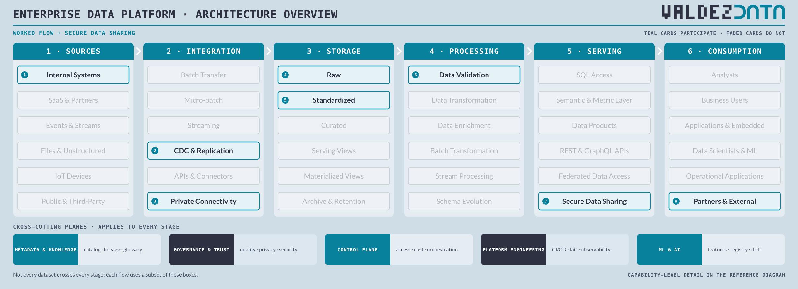
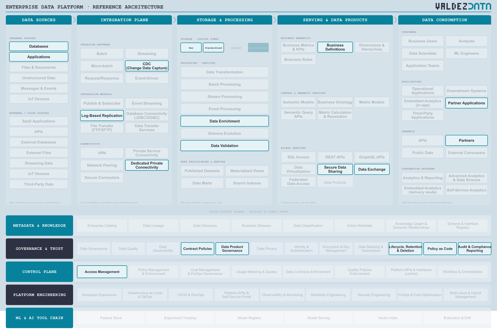

# Secure data sharing with partners

A boundary flow. Data is replicated from the operational systems, conformed enough to be contractually safe, and shared outward with a partner organisation. The hard part is not the pipeline, it is what happens after the data leaves.

## Why this flow is in the catalogue

- It is where governance stops being paperwork. The data leaves your boundary and you still own the obligations attached to it.
- It forces the difference between an internal mart and a contracted external shape. Your reporting model is not what a partner signed up for.
- It exercises the least-used parts of the inventory: retention, deletion, audit reporting and policy as code.

## Stages

| Step | Stage | Box | Guide chapter |
| --- | --- | --- | --- |
| 1 | Sources | Internal Systems | [Sources](../guide/01-data-sources.md) |
| 2 | Integration | CDC & Replication | [Integration](../guide/02-integration-plane.md) |
| 3 | Integration | Private Connectivity | [Integration](../guide/02-integration-plane.md) |
| 4 | Storage | Raw | [Storage](../guide/03-enterprise-platform.md) |
| 5 | Storage | Standardized | [Storage](../guide/03-enterprise-platform.md) |
| 6 | Processing | Data Validation | [Processing](../guide/03-enterprise-platform.md) |
| 7 | Serving | Secure Data Sharing | [Serving](../guide/04-serving-access.md) |
| 8 | Consumption | Partners & External | [Consumption](../guide/06-consumption.md) |

## Capabilities

| Step | Capability | Plane | In plain terms |
| --- | --- | --- | --- |
| 1 | Databases | [Data Sources](../guide/01-data-sources.md) | Where applications keep their records of truth. |
| 2 | Applications | [Data Sources](../guide/01-data-sources.md) | The software the business runs on: ERP, CRM, billing. |
| 3 | CDC (Change Data Capture) | [Integration Plane](../guide/02-integration-plane.md) | Read the database's change log instead of dumping tables. |
| 4 | Log-Based Replication | [Integration Plane](../guide/02-integration-plane.md) | Keep a running copy of another system by reading its log. |
| 5 | Dedicated Private Connectivity | [Integration Plane](../guide/02-integration-plane.md) | A private circuit to a partner, not the public internet. |
| 6 | Raw | [Enterprise Platform](../guide/03-enterprise-platform.md) | The data exactly as it arrived, untouched. |
| 7 | Standardized | [Enterprise Platform](../guide/03-enterprise-platform.md) | Same names, types and codes regardless of which system it came from. |
| 8 | Data Validation | [Enterprise Platform](../guide/03-enterprise-platform.md) | Check data meets its rules before anyone relies on it. |
| 9 | Data Enrichment | [Enterprise Platform](../guide/03-enterprise-platform.md) | Add context from other data before anyone uses it. |
| 10 | Secure Data Sharing | [Serving & Data Products](../guide/04-serving-access.md) | Grant access inside your own boundary, without exporting a file. |
| 11 | Data Exchange | [Serving & Data Products](../guide/04-serving-access.md) | A governed hand-off of data to another organisation. |
| 12 | Business Definitions | [Serving & Data Products](../guide/04-serving-access.md) | What a business term means, written down once. |
| 13 | Partner Applications | [Data Consumption](../guide/06-consumption.md) | Software a partner runs against your data. |
| 14 | Partners | [Data Consumption](../guide/06-consumption.md) | Other organisations you exchange data with, under contract. |
| 15 | Contract Policies | [Governance & Trust](../guide/08-governance-trust.md) | Agreed rules about what a dataset will contain. |
| 16 | Data Product Governance | [Governance & Trust](../guide/08-governance-trust.md) | Who owns a product, and what it promises. |
| 17 | Policy as Code | [Governance & Trust](../guide/08-governance-trust.md) | Rules written as code, so they can be tested and versioned. |
| 18 | Access Management | [Control Plane](../guide/09-control-plane.md) | Who is allowed to read what. |
| 19 | Lifecycle, Retention & Deletion | [Governance & Trust](../guide/08-governance-trust.md) | How long data is kept, and how it is really removed. |
| 20 | Audit & Compliance Reporting | [Governance & Trust](../guide/08-governance-trust.md) | Evidence, on demand, that the rules were followed. |

## Not used by this flow

Not a judgement: these capabilities are simply not on the path. Streaming, Curated, Data Products, Analysts, Business Users, Semantic & Metric Layer.

## Notes

- Only Raw and Standardized are used: the partner receives a contracted shape, not an internal mart shaped for your own reporting.
- Secure Data Sharing replaces SQL Access. The boundary here is a permission grant and a contract, not a query engine.
- Lifecycle, Retention & Deletion and Audit & Compliance Reporting are on the path because a shared dataset keeps carrying obligations once it is outside your control.

---

Back to [worked flows](README.md) and the [reference architecture](../README.md).
