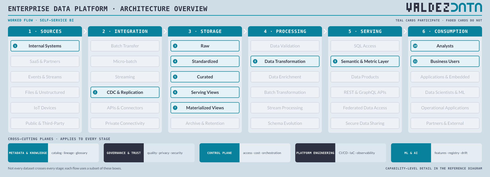
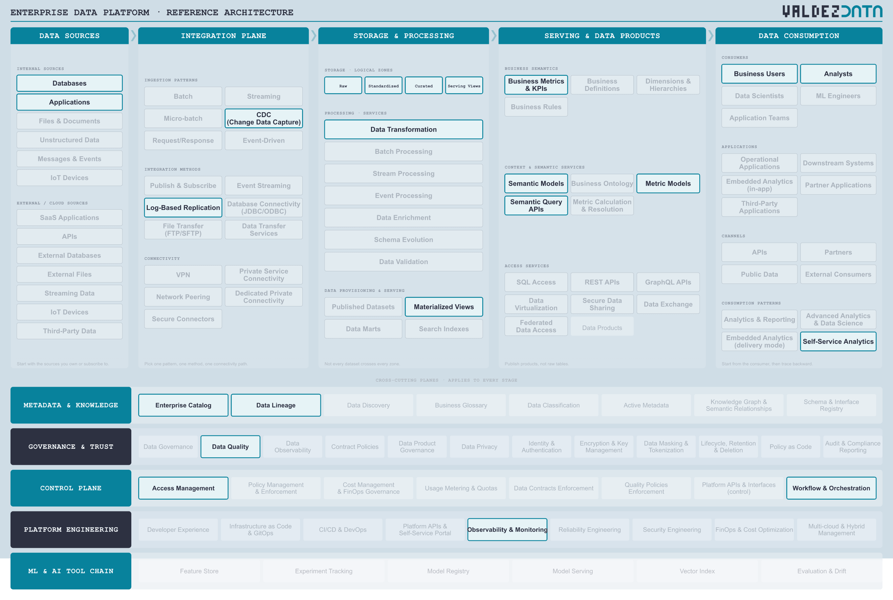

# Self-service BI on a semantic layer

The classic self-service flow. Analysts query a governed model rather than raw tables, dashboards read precomputed results rather than recomputing facts, and the numbers agree because the definitions live in one place.

## Why this flow is in the catalogue

- It is the flow everyone means when they say "the data platform", and the one most often built badly: every dashboard rebuilding the same logic in its own SQL.
- It settles the difference between gold and serving. Curated holds facts and dimensions; serving holds the views and precomputed results that BI actually reads.
- Materialized views are on the path because a dashboard that recomputes a year of facts on every refresh is a cost problem before it is a latency problem.

## Stages

| Step | Stage | Box | Guide chapter |
| --- | --- | --- | --- |
| 1 | Sources | Internal Systems | [Sources](../guide/01-data-sources.md) |
| 2 | Integration | CDC & Replication | [Integration](../guide/02-integration-plane.md) |
| 3 | Storage | Raw | [Storage](../guide/03-enterprise-platform.md) |
| 4 | Storage | Standardized | [Storage](../guide/03-enterprise-platform.md) |
| 5 | Storage | Curated | [Storage](../guide/03-enterprise-platform.md) |
| 6 | Storage | Serving Views | [Storage](../guide/03-enterprise-platform.md) |
| 7 | Storage | Materialized Views | [Storage](../guide/03-enterprise-platform.md) |
| 8 | Processing | Data Transformation | [Processing](../guide/03-enterprise-platform.md) |
| 9 | Serving | Semantic & Metric Layer | [Serving](../guide/04-serving-access.md) |
| 10 | Consumption | Analysts | [Consumption](../guide/06-consumption.md) |
| 11 | Consumption | Business Users | [Consumption](../guide/06-consumption.md) |

## Capabilities

| Step | Capability | Plane | In plain terms |
| --- | --- | --- | --- |
| 1 | Databases | [Data Sources](../guide/01-data-sources.md) | Where applications keep their records of truth. |
| 2 | Applications | [Data Sources](../guide/01-data-sources.md) | The software the business runs on: ERP, CRM, billing. |
| 3 | CDC (Change Data Capture) | [Integration Plane](../guide/02-integration-plane.md) | Read the database's change log instead of dumping tables. |
| 4 | Log-Based Replication | [Integration Plane](../guide/02-integration-plane.md) | Keep a running copy of another system by reading its log. |
| 5 | Raw | [Enterprise Platform](../guide/03-enterprise-platform.md) | The data exactly as it arrived, untouched. |
| 6 | Standardized | [Enterprise Platform](../guide/03-enterprise-platform.md) | Same names, types and codes regardless of which system it came from. |
| 7 | Curated | [Enterprise Platform](../guide/03-enterprise-platform.md) | Joined, deduplicated, modelled, and trusted enough to publish. |
| 8 | Serving Views | [Enterprise Platform](../guide/03-enterprise-platform.md) | Views and stored query results built for consumers, not new source records. |
| 9 | Data Transformation | [Enterprise Platform](../guide/03-enterprise-platform.md) | Reshape data: clean it, join it, aggregate it. |
| 10 | Materialized Views | [Enterprise Platform](../guide/03-enterprise-platform.md) | Query results stored and refreshed so dashboards do not recompute them. |
| 11 | Semantic Models | [Serving & Data Products](../guide/04-serving-access.md) | Business-friendly definitions sitting over physical tables. |
| 12 | Metric Models | [Serving & Data Products](../guide/04-serving-access.md) | One agreed definition per number, computed in one place. |
| 13 | Business Metrics & KPIs | [Serving & Data Products](../guide/04-serving-access.md) | The numbers the business actually reports. |
| 14 | Semantic Query APIs | [Serving & Data Products](../guide/04-serving-access.md) | Ask for data using business terms instead of table names. |
| 15 | Analysts | [Data Consumption](../guide/06-consumption.md) | People who answer business questions with data. |
| 16 | Business Users | [Data Consumption](../guide/06-consumption.md) | People who read dashboards and never write SQL. |
| 17 | Self-Service Analytics | [Data Consumption](../guide/06-consumption.md) | Business users answering their own questions without raising a ticket. |
| 18 | Enterprise Catalog | [Metadata & Knowledge](../guide/07-metadata-knowledge.md) | The index of what data exists, and where. |
| 19 | Data Lineage | [Metadata & Knowledge](../guide/07-metadata-knowledge.md) | A map of where data came from and what it feeds. |
| 20 | Data Quality | [Governance & Trust](../guide/08-governance-trust.md) | Checks that data is correct, complete and on time. |
| 21 | Access Management | [Control Plane](../guide/09-control-plane.md) | Who is allowed to read what. |
| 22 | Workflow & Orchestration | [Control Plane](../guide/09-control-plane.md) | Deciding what runs when, in what order, and what to do on failure. |
| 23 | Observability & Monitoring | [Platform Engineering](../guide/10-platform-engineering.md) | Noticing when something is broken, slow or late. |

## Not used by this flow

Not a judgement: these capabilities are simply not on the path. Streaming, Micro-batch, Data Products, REST & GraphQL APIs, Federated Data Access, Secure Data Sharing.

## Notes

- Serving Views and Materialized Views are two steps on purpose. A logical view is a saved query evaluated on every read; a materialized view stores the results and refreshes them in the background.
- Data Transformation sits here rather than Batch Transformation, because the work is modelling facts and dimensions, not moving files around.
- The semantic layer is what stops every team computing revenue their own way. It is also where self-service usually fails, when the definitions are wrong or nobody owns them.

---

Back to [worked flows](README.md) and the [reference architecture](../README.md).
